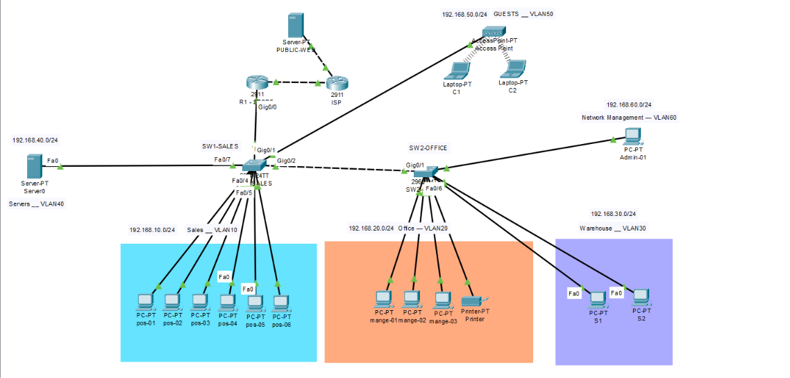
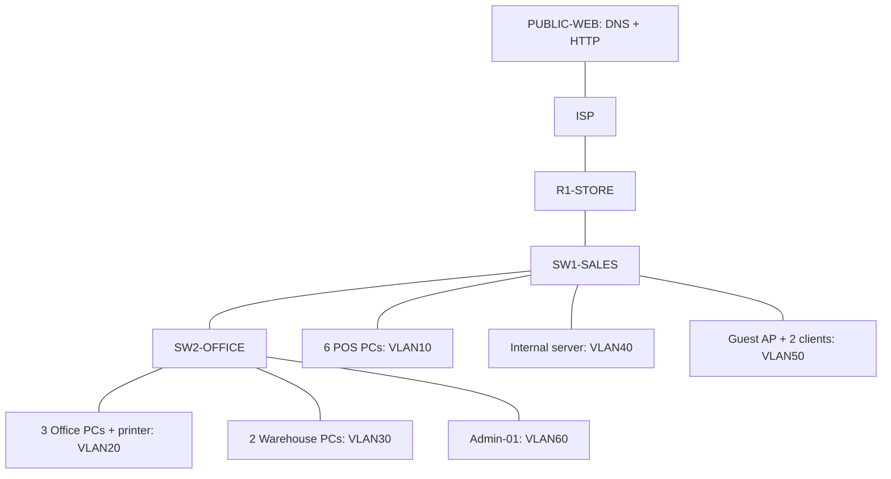

# Topology and port map

This is the layout I used for the store. The port map follows the switch exports and the final topology screenshot.

| Device / port | Intended peer | Function |
|---|---|---|
| R1 G0/0 | SW1 G0/1 | 802.1Q trunk; VLANs 10,20,30,40,50,60 |
| SW1 G0/2 | SW2 G0/1 | Inter-switch trunk; same VLAN list |
| R1 G0/1 | ISP G0/0 | WAN 203.0.113.0/30 |
| ISP G0/1 | PUBLIC-WEB Fa0 | External DNS/HTTP segment |
| SW1 Fa0/1–6 | POS-01–06 | VLAN10 |
| SW1 Fa0/7 | Internal server | VLAN40 |
| SW1 Fa0/8 | Guest AP | VLAN50 |
| SW2 Fa0/1–3 | Office PCs | VLAN20 |
| SW2 Fa0/4 | Printer | VLAN20 |
| SW2 Fa0/5–6 | Warehouse PCs | VLAN30 |
| SW2 Fa0/7 | Admin-01 | VLAN60 |
| SW1 Fa0/9–24 | Unused | Disabled |
| SW2 Fa0/8–24 | Unused | Shutdown in observed export |
| SW2 G0/2 | Intended unused | Disabled during cleanup |

Fresh-build templates explicitly create all six VLANs on both switches. VLAN60 keeps the historical name ADMIN. No redundant links or routing protocol have been added.
