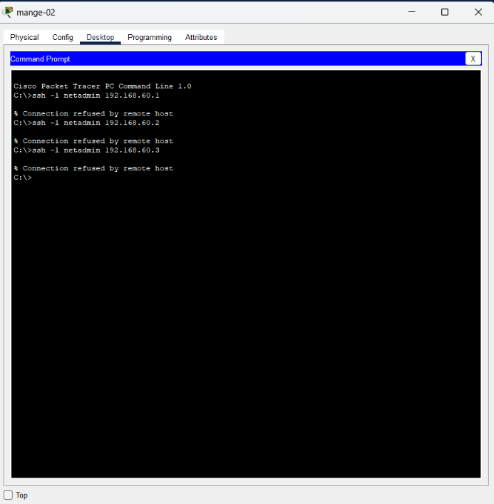
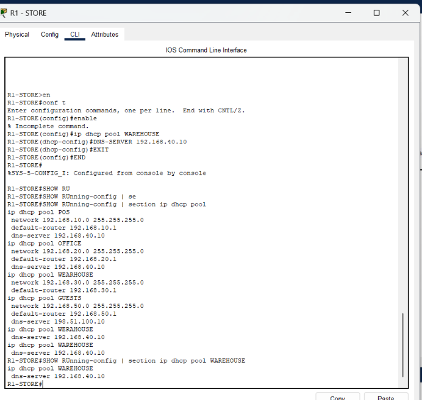
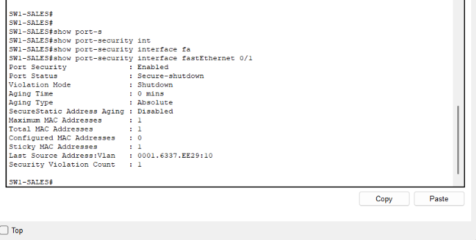

# Troubleshooting journal

## Office could SSH to SW2

I expected only Admin-01 to be able to log in, but an Office PC reached the SW2 prompt.

I checked the source ACL first. It allowed the correct address, `192.168.60.10`. Then I checked:

```text
show running-config | section line vty
```

The restriction was only under `line vty 15`. The other lines weren't covered.

I applied the settings under `line vty 0 15` and started new SSH sessions from both devices. Office was rejected, and Admin-01 could log in.



## Warehouse got an address but no DNS

The Warehouse PC received `192.168.30.21` and the right gateway, but DNS stayed at `0.0.0.0`.

The DHCP configuration showed several similar names. The network and gateway were in `WEARHOUSE`, while I'd added DNS to a differently spelled pool.

I added DNS to the pool actually serving VLAN30, then ran:

```text
ipconfig /release
ipconfig /renew
```

After that, the Warehouse PCs could open the portal by name. I later removed the unused pools.



## Testing port security

I let SW1 Fa0/1 learn the MAC of pos-01, then connected a different PC and sent traffic. The violation counter increased and the port entered Secure-shutdown.



To recover it, I reconnected pos-01 and used:

```text
configure terminal
interface fastEthernet 0/1
 shutdown
 no shutdown
end
```

I kept the sticky MAC entry because the original PC was still the intended device.

## Exercise I'd like to try next

In a separate copy, remove VLAN30 from the inter-switch trunk, diagnose why Warehouse loses access, and restore it.

I haven't completed that exercise yet. I'd record the symptom, commands used, cause, fix and the result after recovery.
